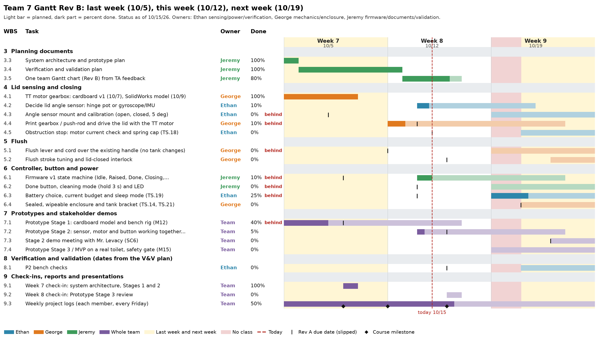

# Week 8 - Project Log
### ECSE 395 - Jeremy Lee (`jcl212`)

---

## Individual Contributions

**October 12, 2026 - Feedback on the System Architecture**
Our System Architecture and Prototype Plan got a 98/100. Leyi Yu asked for two things: describe the mechanical structure in more detail, and put all of our tasks, milestones and deadlines into a single Gantt chart and keep it updated, because some of our dates didn't match.

**October 12, 2026 - Verification and Validation Plan**
Wrote our Verification and Validation Plan from the handout, our Rev B specs and the 9 risks in the System Architecture. It traces every TS to a test with a pass number, and it has one full protocol for the riskiest part, closing the lid (25 normal trials, 5 low-battery trials and 10 standing trials with the seat up). My first draft was too long, so after the team's comments (see below) we cut it down to 6 pages. We took out the home trial and the plan to recruit 12 people. The volunteer check is now up to five people, and only after Prof. Fu tells us what approval we need. I submitted it on Canvas at 11:42 PM and put the PDF and an editable Word copy in our Drive folder `07 Verification & Validation`.

**October 15, 2026 - One Gantt chart (Rev B)**
While looking into the TA's comment I found we had two Gantt charts that didn't agree with each other: the Google Sheet we submitted with Concept Selection, and the Rev A chart in my Concept Selection document. I merged them into one chart, `ECSE395_Team7_Gantt_RevB`, that runs from August 24 to December 4. Changes:
- Fixed the task numbers (everything under sections 5 and 6 was numbered 4.x) and the typo the grader pointed out (annd).
- Removed "Test Seat/User Detection" since Concept C+ has nothing on the seat, and removed the midterm design report since it isn't in the course schedule.
- Added the syllabus milestones and the test dates from the V&V plan (P2 checks, MVP safety gate by October 28, final verification November 2-13, analysis November 16-18, report by November 25).
- Added a percent done and a status for every task. Our prototype work is behind, so I moved the Stage 1 and Stage 2 tasks about a week later and kept the old due date in its own column so you can see what slipped.
- Added a task to decide between the hinge potentiometer and a gyroscope sensor for the lid angle.

I uploaded it to our Drive folder `05 Concept Selection & Gantt`. Here is the part for last week and next week that we will go over at the check-in:

---

## Team Contributions

**October 12, 2026 - Team discussion of the V&V plan (group chat)**
Present: Ethan Sloat, George Guaman, Jeremy Lee

George read the draft and said it was too long and too heavily formatted, that our professor is Prof. Fu (the draft said Dr. Block), and that a home trial and recruiting guests weren't realistic for us. He also asked whether Prof. Fu wanted an ideal validation plan or a realistic one.

What we decided:
Cut the plan to about 6 pages, drop the home trial and the recruiting, keep the volunteer check small and only do it after asking Prof. Fu, and submit that night.

Action items:
Jeremy makes the cuts and submits (done 11:42 PM). The team asks Prof. Fu what approval a volunteer check needs.

**October 15, 2026 - Prototype status**
We haven't built much past George's cardboard and SolidWorks gearbox from last week, so the Stage 1 and Stage 2 tasks are behind on the new Gantt chart. We are also thinking about switching from the hinge potentiometer to a gyroscope sensor to measure the lid angle, which would change how we mount the sensor and how we calibrate it.

---

## Next steps
- Week 8 check-in (design review of Prototype Stage 3) on October 16 at 2:05 PM in Sears Lab: go over the V&V plan, what we learned from Stages 1 and 2, the plan for Stage 3, and the Gantt chart for last week and next week
- Decide hinge potentiometer or gyroscope by October 21
- Firmware v1 state machine and Stage 2 (sensor, motor and button working together) by October 23
- MVP on a real toilet by October 28
- Ask Prof. Fu what approval we need before any volunteer check
- No class October 19-20 (fall break)
